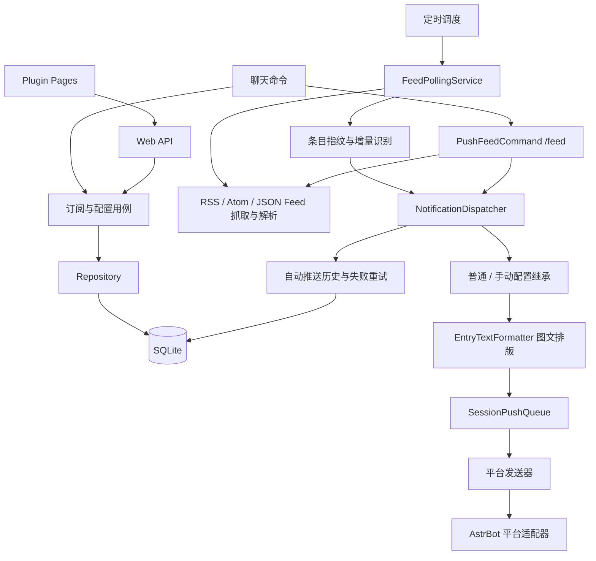

# RssHub lite

为 AstrBot 提供 RSS、Atom、JSON Feed 订阅与推送，保留定时抓取、去重、媒体、失败重试和管理页面，移除 AI 内容处理器、LLM 工具和知识库。

**插件 ID：** `astrbot_plugin_rsshub_lite` · **首个公开版本：** `v0.1.0` · **AstrBot：** `>=4.24.0`

[源码](https://github.com/Junnstoy/astrbot_plugin_rsshub_lite) · [发布包](https://github.com/Junnstoy/astrbot_plugin_rsshub_lite/releases) · [使用文档](docs/usage/README.md) · [变更记录](CHANGELOG.md)

本项目是 [AstrBot-Elementary-School/astrbot_plugin_rsshub](https://github.com/AstrBot-Elementary-School/astrbot_plugin_rsshub) 的修改版本，基于上游 **v2.1.4**、固定提交 [`a047f46e47cb2a0f7a795f30b9f82ae027005846`](https://github.com/AstrBot-Elementary-School/astrbot_plugin_rsshub/tree/a047f46e47cb2a0f7a795f30b9f82ae027005846)，继续按 **GNU AGPL v3** 开源。上游作者和来源说明见 [NOTICE](NOTICE.md)，完整许可证见 [LICENSE](LICENSE)。

## 与原版的区别

| 能力 | 上游基线 | RssHub lite |
| --- | --- | --- |
| 订阅、定时抓取、条件请求与去重 | 支持 | 保留 |
| SQLite、推送历史、失败重试、会话队列 | 支持 | 保留并扩展显示配置迁移 |
| 图片、音视频、文件、表格图片与缓存 | 支持 | 保留，发送方式明确区分直接/合并 |
| Plugin Pages | 订阅、用户、Feed、历史、设置及 AI 页面 | 保留基础管理页面 |
| AI 处理器、改写/过滤、LLM tools | 支持 | 移除 |
| RSSHub Routes 知识库、Agent XML 推送 | 支持 | 移除 |
| 立即查看订阅内容 | 原版测试入口 | 新增 `/feed <订阅ID> <N>`，最新条目组成一个合并转发包 |
| 普通与手动推送设置 | 共用基础显示设置 | 分成两套独立继承配置 |
| 插件身份与运行数据 | `astrbot_plugin_rsshub` | 独立的 `astrbot_plugin_rsshub_lite` |

lite 表示功能范围收敛，不代表移除媒体依赖或改写为另一套数据库。普通 HTML 清洗和格式化继续执行，不调用模型。

## 安装

使用 AstrBot `>=4.24.0` 及宿主要求的 Python 环境。在 AstrBot 插件管理中通过仓库地址安装，或从 [Releases](https://github.com/Junnstoy/astrbot_plugin_rsshub_lite/releases) 下载插件 ZIP 后上传：

```text
https://github.com/Junnstoy/astrbot_plugin_rsshub_lite
```

也可以手动克隆：

```bash
cd AstrBot/data/plugins
git clone https://github.com/Junnstoy/astrbot_plugin_rsshub_lite.git
```

插件目录应为 `AstrBot/data/plugins/astrbot_plugin_rsshub_lite/`。如需手动安装依赖，在 AstrBot 实际运行环境执行：

```bash
python -m pip install -r data/plugins/astrbot_plugin_rsshub_lite/requirements.txt
```

重载插件后设置 `basic_config.rsshub_base_url`，默认 `https://rsshub.app`，也可使用自己的 RSSHub 实例。RSSHub 路由是否可访问取决于实例、网络和对应站点的要求。

原版与 lite 的部分聊天命令相同，切换使用时请停用另一份插件，避免重复响应或重复推送。lite 使用独立数据目录，不会自动读取原版或其他框架插件的数据库；可通过 TOML 导出/导入重新建立订阅。

## 快速使用

在希望接收推送的群聊或私聊中订阅完整 Feed 链接：

```text
/sub https://example.com/feed.xml
/sub_list
/unpush 12
/push 12
```

请将示例 URL 换成实际 Feed，将 `12` 换成列表方括号内的订阅 ID。也支持 RSSHub 路由，例如 `/sub /bilibili/user/dynamic/123456`，其中账号 ID 需替换。新订阅默认启用；默认首次轮询只建立历史基线。

| 命令 | 作用 |
| --- | --- |
| `/sub <URL或路由> [更多目标...]` | 在当前会话新增订阅 |
| `/sub_list [page] [page_size]` | 查看自己在当前会话的订阅，默认每页 5 条 |
| `/push <ID[,ID...]\|all>` | 持续开启自动推送 |
| `/unpush <ID[,ID...]\|all>` | 持续关闭自动推送，保留订阅 |
| `/unsub <ID或URL...>` | 删除订阅 |
| `/feed <订阅ID> <N>` | 管理员即时抓取最新 N 条，按新到旧合并转发 |
| `/push_status` | 查看当前会话正在发送或排队的任务 |
| `/push_cancel [job_id\|feed_id\|all]` | 取消本次任务，不关闭以后自动推送 |
| `/sub_profile`、`/sub_session` | 修改订阅/用户设置，或设置当前会话的新订阅模板 |
| `/sub_export`、`/sub_import` | TOML 导出与导入 |
| `/sub_test <订阅ID或URL>` | 管理员诊断推送最新一条 |
| `/rsshelp` | 查看命令帮助 |

`/push`、`/unpush` 操作自己的当前会话订阅；`all` 也仅指这个范围。`/feed` 当前依赖 OneBot 合并转发能力，可重复查看，不改变自动推送开关、去重水位或自动历史。订阅 ID、Feed ID 和 job ID 不相同，取消任务时请使用 `/push_status` 给出的标识。详见[命令说明](docs/usage/commands.md)。

## 两套独立的推送设置

| 设置 | 普通订阅推送 | 手动 `/feed` |
| --- | --- | --- |
| 全局配置 | `global_config` | `feed_defaults` |
| 发送方式 | `1` 直接发送、`2` 合并转发；默认直接 | 固定合并转发 |
| 排版 | `0` 自定义、`2` 原始顺序；默认自定义 | 同左 |
| 作者、来源、标题、媒体、合并媒体 | 默认启用 | 默认启用 |
| RSS 标签 | 默认禁用 | 默认禁用 |
| 用户/订阅字段 | `display_title`、`merge_media` 等 | `feed_display_title`、`feed_merge_media` 等 |

全局显示项使用勾选框；用户和订阅统一使用 `-100` 继承、`0` 禁用、`1` 启用。两套设置分别按 **订阅 → 用户 → 对应全局默认** 解析，不互相回退。例如：

```text
/sub_profile set sub 12 display_title 0
/sub_profile set sub 12 feed_display_title 1
/sub_profile set sub 12 feed_style 2
/feed 12 3
```

这会关闭普通推送额外添加的标题，保留手动推送标题，并让手动推送使用原始正文图文顺序。标题开关不会删除正文自带的相同文字；RSS 标签来自源条目分类，与订阅管理标签 `tags` 不同。

`merge_media` 控制单条内容的文字与媒体是否放在同一消息或转发节点中，与合并转发本身是两个设置。`/sub_session` 仅将模板复制给以后新建的订阅；实际抓取间隔使用订阅 `interval`，用户 `interval` 当前不参与调度。Plugin Pages 保存全局显示默认值后立即应用于后续消息，监控间隔仍需重载。完整配置见[配置说明](docs/usage/configuration.md)。

## 平台边界

| 平台 | 直接发送 | 合并转发 / `/feed` |
| --- | --- | --- |
| OneBot / aiocqhttp | 支持，媒体受协议实现和平台限制 | 支持真正的合并转发 |
| Telegram | 单图或单视频可配正文；多媒体同条需关闭合并媒体 | 当前不支持 |
| QQ Official | 单图文可同条；多媒体或视频+正文需关闭合并媒体 | 当前不支持 |
| Weixin OC | 图文或多媒体组合需关闭合并媒体逐项发送 | 当前不支持 |
| 其他 AstrBot 平台 | 使用通用适配器，以宿主能力为准 | 默认不支持 |

不支持的组合会明确报错，不会用普通多条消息冒充合并转发。媒体仍可能受大小、格式、平台风控与 Bot 适配器影响。自动化测试覆盖代码路径和浏览器界面，当前发布准备过程未完成真实 Bot 平台联测。更多细节见[平台规则](docs/project/platforms.md)。

## 架构



`main.py` 接入宿主，`bootstrap.py` 装配生命周期；领域、应用、基础设施和接口分层保留。手动 `/feed` 只读抓取并整批入队，不写自动推送历史。架构细节见[项目文档](docs/project/architecture.md)。

## 数据

默认持久化目录：

```text
AstrBot/data/plugin_data/astrbot_plugin_rsshub_lite/
├── rsshub.db      # 用户、订阅、Feed、历史与迁移记录
├── cache/         # 媒体和渲染缓存
└── exports/       # TOML 导出文件
```

运行中的任务/会话队列保存在内存，自动失败重试依赖数据库历史。启动配置由 AstrBot 插件设置管理，会话模板由 AstrBot 插件 KV 保存。数据库沿用上游表体系并通过版本迁移增加独立显示字段；旧处理器列仅作结构兼容，不执行 AI。配置和 TOML 当前使用格式版本 3，这与项目发布版本 `v0.1.0` 不同。

## 开发与贡献

```bash
python -m pip install -r requirements-dev.txt
python -m pytest tests
node --test tests/frontend/*.test.mjs
python scripts/package.py
```

开发依赖不随运行依赖安装。测试环境、外网媒体测试和打包规则见[开发文档](docs/dev/README.md)。问题反馈与贡献请提交到[本项目仓库](https://github.com/Junnstoy/astrbot_plugin_rsshub_lite/issues)。

## 许可与致谢

RssHub lite 是对上游的修改版本，按 [GNU AGPL v3](LICENSE) 提供，保留来源、版权和许可声明；不代表上游作者的官方发行或背书。修改说明见 [NOTICE](NOTICE.md)。

感谢上游作者 **FlanChanXwO** 与贡献者，以及上游致谢的 [RSS-to-Telegram-Bot](https://github.com/Rongronggg9/RSS-to-Telegram-Bot)、[AstrBot](https://github.com/AstrBotDevs/AstrBot) 和 [feedparser](https://github.com/kurtmckee/feedparser)。
