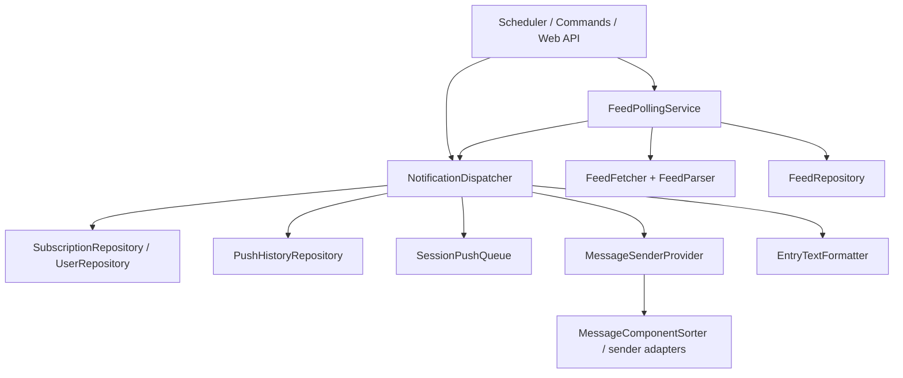

# 架构全景

## 分层结构

项目采用 DDD 分层，目录职责固定：

```text
src/
  domain/          # 实体、值对象、仓库协议、领域规则
  application/     # commands、queries、DTO、应用服务
  infrastructure/  # config、persistence、messaging、fetch、schedule 等实现
  interfaces/      # 命令处理器、Web API
pages/             # Plugin Pages 前端
tests/             # 单元与集成测试
```

## 启动结构

- `main.py`
  - 插件生命周期装饰器
  - 聊天命令入口
- `bootstrap.py`
  - 依赖组装
  - repository / service / command 实例化
  - runtime 启停

这个分工不要反转。`bootstrap.py` 是运行时拥有者，`main.py` 不是总控容器。

## 为什么是这套结构

## 1. 启动与装配分离

- `main.py` 负责把 AstrBot 生命周期和聊天命令接进来
- `bootstrap.py` 负责真正的依赖装配

这样做的原因是：

- 避免 AstrBot 装饰器和运行时组装代码相互污染
- 让应用服务可以脱离插件入口单测
- 让后续新增 Web API、sender、repository 时只改装配层

本精简版已移除 LLM tools 注册与实现；订阅管理继续通过聊天命令和现有 Web API 完成。

## 2. 应用服务收口跨模块用例

这个插件的很多用例天然跨边界：

- polling 需要 fetcher + parser + repository + dispatcher
- dispatch 需要 subscription/user/history/sender/queue

如果把这些逻辑直接散落在命令、Web API 或 scheduler 里，回归会非常频繁。应用服务层存在的意义，就是把“跨模块编排”集中起来。

## 3. 基础设施层吸收平台差异

平台差异主要有三种：

- sender 差异
- config 兼容差异
- persistence / fetch 差异

这些都属于基础设施问题，不应该反向侵入领域语义。比如：

- `-100` 继承是领域语义
- `template_list` 兼容旧平台 sender 配置是基础设施适配

## 核心链路总览

项目的核心运行面可以拆成四条主链：

1. Feed 轮询与增量识别
2. 分发与推送 history
3. 文本格式化与平台消息组件排序
4. 会话级串行发送队列

下面只给全景，细节分别下沉到独立章节。

## 核心运行全景

### 1. 正常轮询推送

1. scheduler 按订阅与 Feed 状态挑选待检查目标
2. `FeedPollingService` 抓取并解析 RSS/Atom/JSON Feed
3. 用“条目指纹组”完成轮询去重，再把 HTML/XML/JSON Feed 内容整理为纯文本 + 结构化媒体
4. `NotificationDispatcher` 为每个订阅解析生效配置
5. 格式化正文、解析通知选项并应用成功态与多 BOT 去重
6. 为待发送项创建 `push_history`，经会话队列调用 sender
7. 根据发送结果更新历史状态及失败重试上下文

详见 [`polling.md`](./polling.md) 与 [`dispatch.md`](./dispatch.md)。

这里要区分两层“去重键”：

- 轮询层：`FeedPollingService` 使用 entry 指纹组维护 `feed.entry_hashes`
- 推送层：`NotificationDispatcher` 使用 `source_key + user_id + target_session + entry_guid` 检查成功态幂等

两者用途不同，前者解决“是不是 feed 里的新条目”，后者解决“这条消息是否已经成功发给过这个目标”。

与基础配置直接相关的真实语义还有四条：

- `minimal_interval` 是配置写入时的硬下限
- `failed_queue_capacity=0` 关闭自动失败重试，但不关闭失败历史
- `failed_queue_max_retries` 只控制自动重试上限
- `deduplicate_multi_bot` 只在同一 `target_session` 且最终 payload 等价时压重，并把被压掉的记录写成 `skipped`

sender 层保持平台差异隔离：`EntryTextFormatter.format_layout` 根据显示开关生成自定义 (`style=0`) 或原始顺序 (`style=2`) 布局，adapter 根据 `send_mode=1/2` 分派到 `send_direct` / `send_merged`。`merge_media` 控制一条内容内部是否共用一个消息或转发节点。真正的合并转发当前仅支持 OneBot，不支持的平台或媒体组合明确报错，不以多条直接消息冒充合并转发。

### 2. 测试推送

- 当目标是 `sub_id` 时，走正式 dispatcher 链路，应用订阅配置。
- 当目标是 URL 时，走轻量直发链路，不读取订阅配置。

这里刻意保留双路径，是为了同时满足：

- 真实订阅回归验证
- 临时 URL 手工测试

独立的 `/feed <订阅ID> <N>` 使用 `PushFeedCommand`：只读抓取并按新到旧选择条目，解析订阅 → 用户 → 全局 `feed_defaults` 的手动显示选项，整个批次和末尾汇总一次进入会话队列，并通过 `send_entries_to_session` 发送一个合并转发包。它不写自动推送历史或去重水位，和上述 `/sub_test` 诊断路径不同。

### 3. 已移除的 AI 链路与兼容数据

内容处理器、Provider/人格调用、LLM tools、XML 即时推送工具及 RSSHub Routes 知识库同步均已移除。`EntryContentContext` 保留在 `services/entry_content.py`，仅承载解析后的条目与媒体，供格式化及历史记录使用。

数据库模型和迁移继续保留原版 `handlers`、`handlers_mode`、`handler_trace` 等字段。旧库中非空的处理器配置不会执行；新历史的 `handler_trace` 留空。已有 `source_type=agent` 历史仍可读取和重试，但不再提供创建这类推送的工具入口。

## 模块关系图



## 配置职责

### 启动级配置

由 `_conf_schema.json` 暴露，主要包含：

- 基础抓取/超时/代理
- 平台 sender 策略
- 普通 `global_config` 与手动 `feed_defaults` 两组全局默认值

插件启动时会在基础设施配置层按 `_conf_schema.json` 做一次配置自愈：补齐缺失字段、删除 schema 外字段、转换可恢复的数值类型，并按 `options` / `slider` 修正非法选项和越界数值。旧 sender strategy 结构和少量 legacy 别名仍在进入运行态配置前归一化；内部字段如 `db_file` 不写回 AstrBot 配置面。

当前配置版本标记为 3，旧枚举在自愈前一次性转换。Plugin Pages 保存两组默认显示值时调用现有 dispatcher 的 `apply_defaults` 热更新；调度间隔仍由 scheduler 持有启动快照。

### 运行级用户/订阅配置

主要放在数据库与 Plugin Pages：

- 订阅选项
- 用户默认配置
- 推送历史自动清理范围

`rsshub_user` 是插件用户事实表。任何写入订阅或推送历史的入口都必须确保对应 `user_id` 存在；启动期数据库自愈也会扫描订阅和推送历史引用，补齐旧库缺失的用户行。Dashboard 删除用户会删除该用户订阅，推送历史默认保留，只有显式选择时才删除历史。

旧 AI 字段的兼容边界见 [`handlers.md`](./handlers.md)；知识库功能移除说明见 [`knowledge.md`](./knowledge.md)。

## 管理界面职责

Plugin Pages 当前管理：

- 订阅列表
- 用户列表
- Feed 列表
- 推送历史
- 默认订阅设置
- 数据管理

Plugin Pages 当前不负责：

- 新建订阅
- 导入订阅
- 导出订阅

聊天命令仍保留 `/sub_import` 的上传等待流：空参数会进入 5 分钟等待，后续文件消息由入口监听器接住并交给同一个 TOML 导入用例处理。

这些仍由聊天命令承担。

## 数据与审计

最重要的排障资产是 `push_history`：

- `content`: 最终可发送文本
- `raw_xml`: 原始条目 XML；JSON Feed 条目会保存插件合成的 RSS `<item>` 片段
- `media_urls`: 媒体链接
- `handler_trace`: 旧库兼容字段，新推送留空，不再生成处理器 trace
- `fail_reason`: 失败原因

因此，任何内容链路改动都要优先保证 history 可读性不回退。

## 深入章节

- [`polling.md`](./polling.md)
- [`dispatch.md`](./dispatch.md)
- [`handlers.md`](./handlers.md)
- [`formatting.md`](./formatting.md)
- [`knowledge.md`](./knowledge.md)
